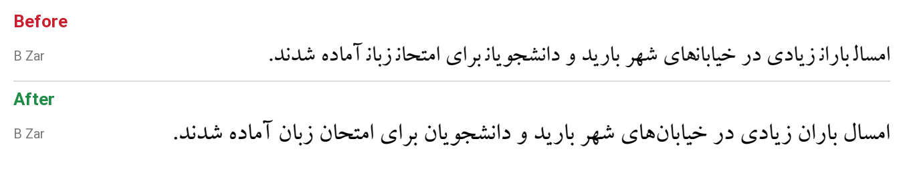

# Persian font fix for Microsoft Word on Mac

[فارسی](README.md)

Legacy Persian fonts such as **B Zar**, **B Nazanin**, **B Titr** and the **Mj_** series render the last letter of many words incorrectly in Word for Mac. For example, «سازمان» shows up as «سازماز» and «ریال» as «ریاا».



## Cause

Arabic-script letters have four forms: initial, medial, final and isolated. These fonts were built for Windows. Their OpenType `GSUB` table defines `init`, `medi` and `fina`, but no `isol` feature, and they have no `GDEF` table.

When Word for Mac finds no `isol` feature, it applies the final form to letters that should stand alone. This usually hits the last letter after a non-joining letter (ا د ر ز و). macOS itself (CoreText) renders the same fonts correctly.

In testing, the same unfixed file installed under a different family name rendered correctly in Word. So Word treats fonts with well-known names such as «B Zar» differently, and in that mode it needs `isol`. Adding the feature fixes the problem and keeps the original name, so existing documents still find the font.

## What the tool does

It appends a single-substitution lookup that maps each letter to its own base glyph, and registers it as `isol` for the `arab` script.

- Glyph outlines, metrics, names, `cmap` and the existing features are not modified.
- Only fonts that need the fix are touched: Arabic `fina` without `isol`, and no `GDEF`.
- The original of every changed file is backed up first.
- Running the tool twice is safe; a fixed font is skipped.

## Usage (macOS)

**Easy:** quit Office, download the ZIP, double-click `run-mac.command` (right-click → Open if macOS blocks it), then reopen Word.

**Terminal:**

```bash
python3 -m pip install fonttools
python3 fix_persian_fonts.py --dry-run          # list fonts that need fixing
python3 fix_persian_fonts.py                    # fix ~/Library/Fonts (and /Library/Fonts if writable)
python3 fix_persian_fonts.py path/to/fonts      # fix a folder or specific files
```

Backups go to `~/Desktop/persian-font-backup-<date>`, or to the folder you pass with `--backup`.

## Why the fonts are not included

The B fonts are © Borna Rayaneh, and the Mj_ fonts are conversions of HacenType fonts. Neither is under a free license, so this repository ships only the tool. Each user fixes the copies they already have.

## License

The code is licensed under [MIT](LICENSE). The license covers the code only, not any font.
