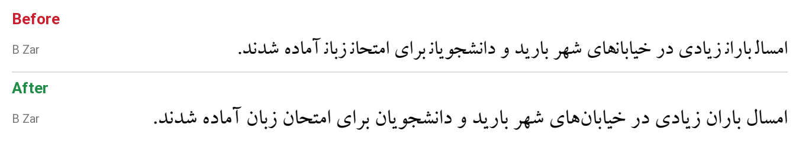

<div dir="rtl">

# اصلاح فونت‌های فارسی در Word مک

[English](README.en.md)

اگر در Word مک با فونت‌هایی مثل **B Zar**، **B Nazanin**، **B Titr** یا فونت‌های **Mj_** تایپ می‌کنید و حرف آخر بعضی کلمه‌ها خراب نمایش داده می‌شود، این ابزار مشکل را حل می‌کند. نمونه‌هایی از این خرابی:

- «سازمان» به شکل «سازماز» درمی‌آید
- «ایران» به شکل «ایراز» درمی‌آید
- «ریال» به شکل «ریاا» و «هلال» به شکل «هلاا» درمی‌آید



## مشکل از کجاست؟

در خط فارسی هر حرف چهار شکل دارد: آغازی، میانی، پایانی و تنها. فونت قاعده‌هایی دارد که مشخص می‌کند هر حرف در هر موقعیت کدام شکل را بگیرد.

فونت‌های قدیمی سری B و Mj_ برای ویندوز ساخته شده‌اند. سه قاعده‌ی آغازی، میانی و پایانی را دارند، اما قاعده‌ی **«تنها» (isol)** را ندارند. Word مک در این حالت برای حرفی که باید تنها باشد، شکل پایانی را می‌کشد. این حرف معمولاً حرف آخر کلمه است که بعد از ا، د، ر، ز یا و می‌آید. نتیجه این است که نون پایانی شبیه «ز» و لام پایانی شبیه «ا» دیده می‌شود.

خود macOS این فونت‌ها را درست نمایش می‌دهد. مشکل فقط در Word (و گاهی بقیه‌ی برنامه‌های Office) دیده می‌شود.

یک نکته‌ی جالب در آزمایش‌ها: اگر همین فایل اصلاح‌نشده را با نام دیگری نصب کنید، Word آن را درست نشان می‌دهد. یعنی Word با فونت‌هایی که نام شناخته‌شده‌ای مثل «B Zar» دارند رفتار متفاوتی دارد و در آن حالت به قاعده‌ی «تنها» نیاز دارد. اضافه شدن این قاعده مشکل را بدون تغییر نام فونت حل می‌کند، پس سندهای قبلی شما همان فونت را پیدا می‌کنند.

## این ابزار چه می‌کند؟

ابزار قاعده‌ی «تنها» را به فونت اضافه می‌کند و برای هر حرف، شکل تنها را همان شکل اصلی خودش قرار می‌دهد.

- **طراحی حروف، فاصله‌ها، نام فونت و بقیه‌ی قاعده‌ها دست نمی‌خورد.**
- فقط فونت‌هایی تغییر می‌کنند که این قاعده را ندارند. فونت‌های سالم و فونت‌های جدید مثل Vazirmatn تغییر نمی‌کنند.
- پیش از هر تغییر، از فایل اصلی نسخه‌ی پشتیبان گرفته می‌شود.
- اجرای دوباره‌ی ابزار بی‌خطر است. فونتی که یک بار اصلاح شده، دوباره تغییر نمی‌کند.

## روش استفاده (مک)

### راه ساده

۱. Word و بقیه‌ی برنامه‌های Office را ببندید.

۲. این مخزن را دانلود کنید: دکمه‌ی سبز **Code** و بعد **Download ZIP**. سپس فایل ZIP را باز کنید.

۳. روی فایل `run-mac.command` دوبار کلیک کنید.
   - اگر macOS اجازه‌ی اجرا نداد، روی فایل راست‌کلیک کنید و **Open** را بزنید.
   - بار اول ممکن است چند ثانیه طول بکشد، چون کتابخانه‌ی لازم (fonttools) نصب می‌شود.

۴. Word را دوباره باز کنید.

نسخه‌ی پشتیبان فونت‌های اصلی روی Desktop در پوشه‌ای با نام `persian-font-backup-…` ذخیره می‌شود.

### از طریق Terminal

```bash
python3 -m pip install fonttools
python3 fix_persian_fonts.py --dry-run   # فقط فهرست فونت‌هایی که مشکل دارند
python3 fix_persian_fonts.py             # اصلاح فونت‌های کاربر در ~/Library/Fonts
```

برای اصلاح فونت‌های یک پوشه یا چند فایل مشخص:

```bash
python3 fix_persian_fonts.py path/to/fonts-folder
python3 fix_persian_fonts.py BZar.ttf BNazanin.ttf
```

فونت‌هایی که در `/Library/Fonts` نصب شده‌اند به دسترسی مدیر نیاز دارند. ابزار آن‌ها را جدا فهرست می‌کند تا با `sudo` اجرا کنید.

## برگرداندن تغییرات

فایل‌های پوشه‌ی پشتیبان را دوباره در `~/Library/Fonts` کپی کنید و گزینه‌ی Replace را بزنید. بعد Word را دوباره باز کنید.

## چرا خود فونت‌ها اینجا نیستند؟

فونت‌های سری B متعلق به شرکت برنا رایانه هستند. فونت‌های Mj_ هم نسخه‌ی تبدیل‌شده‌ی فونت‌های HacenType هستند. هیچ‌کدام مجوز آزاد برای بازنشر ندارند. به همین دلیل این مخزن فقط ابزار اصلاح را منتشر می‌کند و هر کس فونت‌هایی را که خودش دارد اصلاح می‌کند.

## مجوز

کد این ابزار با مجوز [MIT](LICENSE) منتشر شده است. این مجوز فقط شامل کد است و شامل هیچ فونتی نمی‌شود.

</div>
